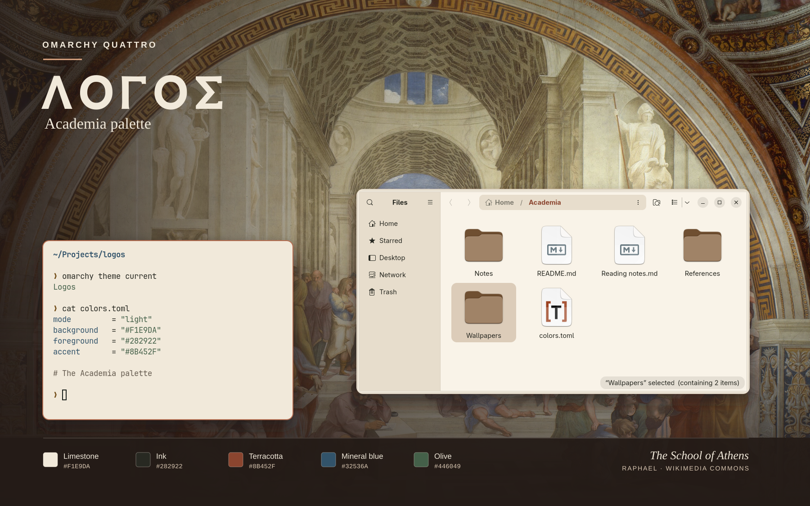
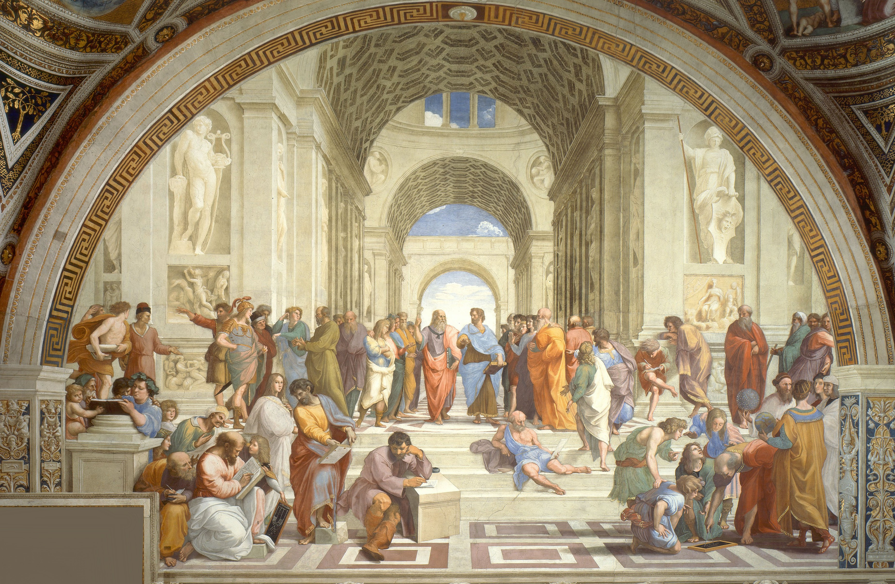
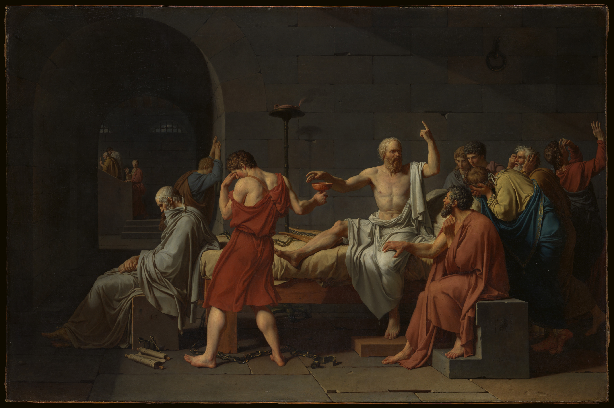

# Lógos

A light theme for Omarchy Quattro inspired by Greek philosophy and the painted
architecture of Raphael's *School of Athens*. The Academia palette pairs
limestone and warm paper with ink, terracotta, mineral blue, and olive.



The preview combines real Alacritty and Nautilus captures from an isolated
session with a sample folder and Raphael's fresco.

## Wallpapers

| The School of Athens | The Death of Socrates |
| --- | --- |
|  |  |

## Installation

```sh
omarchy theme install https://github.com/gabrielfranh/omarchy-logos-theme.git
```

Omarchy installs and applies Lógos in one step. To switch back to it later,
run `omarchy theme set logos`. The installer replaces any existing copy in
`~/.config/omarchy/themes/logos/`.

Omarchy uses the palette for the shell, window borders, terminal, and other
supported apps. Use `omarchy theme bg next` to switch between the two wallpapers.

### Optional: match GNOME Files (Nautilus)

Skip this step if you use another file manager or prefer the standard GNOME
Files colors. The Lógos theme works without it.

This integration gives Files the Academia palette: a stone sidebar, a warm
paper background, terracotta highlights, and sand-colored selections. To
enable it, run these commands once after installing Lógos:

```sh
omarchy hook install theme-set "$HOME/.config/omarchy/themes/logos/hooks/logos-nautilus"
omarchy theme set logos
```

The first command registers a small script that Omarchy runs when you switch
themes. It enables the Files colors for Lógos and disables them for other
themes. The second command applies the colors now. If Files was already
running, quit and reopen it to see the change.

To undo this setup:

1. Remove `~/.config/omarchy/hooks/theme-set.d/logos-nautilus`.
2. In `~/.config/gtk-4.0/gtk.css`, remove only the line
   `@import url("logos-nautilus.css");`.
3. Remove `~/.config/gtk-4.0/logos-nautilus.css`, then quit and reopen Files.

## Design

See the [palette, surface mapping, and contrast review](DESIGN.md). The **ΛΟΓΟΣ**
wordmark in the preview uses **GFS Neohellenic Bold** by the Greek Font Society.
The [font](fonts/GFSNeohellenicBold.ttf) is included under the
[SIL Open Font License 1.1](fonts/OFL.txt). Interface and terminal fonts follow
the user's Omarchy settings.

## Artwork and inspiration

- [Pathos by Haflier](https://github.com/Haflier/omarchy-pathos-theme),
  inspiration for a desktop theme about philosophy.
- [*The School of Athens* by Raphael](https://commons.wikimedia.org/wiki/File:Raphael_School_of_Athens.jpg),
  a public-domain reproduction from Wikimedia Commons, 3697 × 2414.
- [*The Death of Socrates* by Jacques-Louis David](https://www.metmuseum.org/art/collection/search/436105),
  a public-domain reproduction from The Metropolitan Museum of Art, 4000 × 2663.
